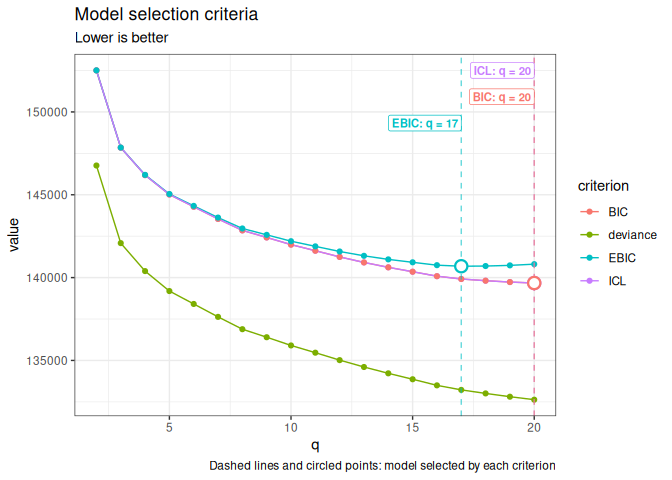
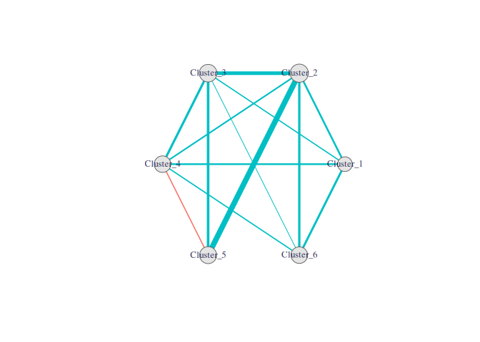

# normalblockr: Gaussian models with latent clustering of variables


<!-- badges: start -->

[](https://github.com/jchiquet/normalblockr/actions/workflows/R-CMD-check.yaml)
[](https://app.codecov.io/github/jchiquet/normalblockr?branch=master)
[](https://lifecycle.r-lib.org/articles/stages.html)
[](https://www.gnu.org/licenses/gpl-3.0)
[](https://github.com/jchiquet/normalblockr/commits/master)
<!-- badges: end -->

## Description

> **normalblockr** fits Gaussian models with a latent clustering of the
> variables. The Normal-Block model[^1] is a Gaussian graphical model
> that clusters variables by how they *covary* and, building on the
> graphical lasso[^2], infers a network of statistical dependencies
> *between clusters* rather than between individual variables. A
> complementary family clusters variables by how they *respond* to
> covariates. The package fits both by (variational) EM, with tools for
> model selection, visualization and diagnostics. See [the
> vignettes](https://jchiquet.github.io/normalblockr/articles/) for a
> comprehensive introduction.

Two model families are reached through the same
`normal_block()`/`NormalBlockData` interface:

- **Normal-Block-Var** (`model = "var"`, the default): variables are
  clustered by their covariance,
  $Y_i = B^\top X_i + C W_i + \varepsilon_i$ with a latent
  $W_i \sim \mathcal N(0, \Omega^{-1})$ shared within a cluster;
  $\Omega$ is the network between clusters.
- **Normal-Block-Mean** (`model = "mean"`): variables are clustered by
  their response to the covariates. All variables of a cluster share one
  regression profile, $\mu_i = C B^\top X_i$ with $B$ of size
  $d \times q$ instead of $d \times p$; the residual covariance is
  diagonal (the default), spherical, or full.

For both families, the following are independent choices of the same
call:

- **Known or unknown clusters**: the grouping of variables is given
  (e.g. from prior knowledge), or inferred by a variational EM, for a
  single number of clusters or over a range explored as a collection,
  with model selection by BIC, ICL, EBIC or cross-validation.
- **Sparse network**: an $\ell_1$ penalty on the precision matrix, for a
  single penalty or a path, selected by a criterion or by stability
  (StARS).
- **Zero-inflation**: an excess-of-zeros layer for data (e.g. abundance
  or biomass tables) with more exact zeros than a Gaussian model can
  represent.

The two families answer different questions and generally return
different groupings; `normal_block_sequential()` runs one after the
other when both are of interest. See the [mean-block
vignette](https://jchiquet.github.io/normalblockr/articles/mean-block-breast-cancer.html).

## Installation

Install the released version from CRAN:

``` r
install.packages("normalblockr")
```

or the development version from
[GitHub](https://github.com/jchiquet/normalblockr):

``` r
# install.packages("pak")
pak::pak("jchiquet/normalblockr")
```

## Illustration

We illustrate the known-/unknown-clusters and sparse variants on
`brca_rppa`[^3]: reverse-phase protein array measurements of 163
proteins across 346 breast cancer tumor samples from The Cancer Genome
Atlas, together with each sample’s PAM50 molecular subtype.

``` r
library(normalblockr)
data(brca_rppa)
Y    <- as.matrix(brca_rppa$expr)
X    <- model.matrix(~ 0 + PAM50_SUBTYPE, data = brca_rppa$covariates)
data <- NormalBlockData$new(Y, X)
```

### Known clusters

A simple, fully data-driven grouping (hierarchical clustering on the raw
expression profiles, with no reference to the Normal-Block model) handed
to `normal_block()` as fixed – only the network between the 6 blocks is
estimated.

``` r
hc    <- brca_rppa$expr |> scale() |> t() |> dist() |> hclust("ward.D2")
group <- model.matrix(~ 0 + factor(cutree(hc, 6)))
m_known <- normal_block(data, blocks = group)
```

    Fitting a diagonal normal-block-var model with fixed clusters 

    DONE

``` r
m_known
```

    A diagonal normal-block-var model with fixed clusters.
    ===========================================================================
     nb_param q n_edges sparsity    loglik deviance      BIC      ICL   EBIC niter
          999 6      15        0 -70387.84 140775.7 146616.3 146616.3 146670    14
    ===========================================================================
    * Useful fields
        $model_par, $posterior_par / $var_par, $clustering 
        $loglik, $BIC, $ICL, $objective, $nb_param, $criteria
    * Useful S3 methods
        print(), summary(), plot(), coef(), sigma(), fitted(), predict() 

### Unknown number of clusters

Leave the clustering for the model to infer, over a range of candidate
cluster counts explored as a collection (each model initialized by
`kmeans`, then the whole collection polished by `refine()`), then select
by ICL.

``` r
m_unknown <- normal_block(data, blocks = 2:20)
```

    Fitting a collection of diagonal normal-block-var models over q 
         refine(): improved 16 of 19 models

    DONE

``` r
plot(m_unknown)
```



``` r
m_unknown$get_best_model("EBIC")
```

    A diagonal normal-block-var model with 17 unknown clusters.
    ===========================================================================
     nb_param  q n_edges sparsity    loglik deviance      BIC      ICL     EBIC
         1147 17     136        0 -66611.15 133222.3 139916.1 139916.1 140686.8
     niter
        47
    ===========================================================================
    * Useful fields
        $model_par, $posterior_par / $var_par, $clustering 
        $loglik, $BIC, $ICL, $objective, $nb_param, $criteria
    * Useful S3 methods
        print(), summary(), plot(), coef(), sigma(), fitted(), predict() 

### Sparse network

Treating a clustering as fixed (known, or selected above), explore a
path of graphical-lasso penalties on the inter-cluster network and
select by BIC. Unlike the dense, unpenalized network, this is the one
actually worth visualizing.

``` r
m_sparse <- normal_block(data, blocks = group, sparsity = TRUE)
```

    Fitting a collection of diagonal normal-block-var models over sparsity penalties, with fixed clusters 

    DONE

``` r
sp_best  <- m_sparse$get_best_model("BIC")
sp_best$plot_network()
```



### Zero-inflated data

For data with an excess of exact zeros beyond what a plain Normal model
would represent (e.g. abundance/biomass tables), `zero_inflation = TRUE`
adds a per-variable excess-of-zero layer. Illustrated on `onema`[^4]:
total biomass of 46 fish species across 399 French stream electrofishing
stations, where seven in ten entries are exact zeros.

``` r
data(onema)
X_zi    <- model.matrix(~ 1 + temperature_med, data = onema$covariates)
Y_zi    <- log(1 + onema$biomass)
data_zi <- NormalBlockData$new(Y_zi, X_zi)
m_zi    <- normal_block(data_zi, blocks = 2:8, zero_inflation = TRUE)
```

    Fitting a collection of zero-inflated diagonal normal-block-var models over q 
         refine(): improved 6 of 7 models

    DONE

``` r
m_zi$get_best_model("ICL")
```

    A zero-inflated diagonal normal-block-var model with 4 unknown clusters.
    ===========================================================================
     nb_param q n_edges sparsity   loglik deviance      BIC      ICL     EBIC niter
          197 4       6        0 -13523.7  27047.4 28220.75 28241.19 28237.38     8
    ===========================================================================
    * Useful fields
        $model_par, $posterior_par / $var_par, $clustering 
        $loglik, $BIC, $ICL, $objective, $nb_param, $criteria
    * Useful S3 methods
        print(), summary(), plot(), coef(), sigma(), fitted(), predict() 

## Learning more

- [`normal-block`](https://jchiquet.github.io/normalblockr/articles/normal-block.html)
  (`vignette("normal-block")`): a general introduction on simulated data
  – known/unknown clusters, sparsity, zero-inflation.
- [`zero-inflated-normal-block`](https://jchiquet.github.io/normalblockr/articles/zero-inflated-normal-block.html)
  (`vignette("zero-inflated-normal-block")`): a full worked example on
  `onema`, with the math behind the zero-inflation extension.
- [`breast-cancer-proteomics`](https://jchiquet.github.io/normalblockr/articles/breast-cancer-proteomics.html)
  (`vignette("breast-cancer-proteomics")`): a full worked example on
  `brca_rppa` – known vs. inferred clustering, model selection, the
  post-hoc `refine()` step, sparsifying the selected network.
- [`mean-block-breast-cancer`](https://jchiquet.github.io/normalblockr/articles/mean-block-breast-cancer.html)
  (`vignette("mean-block-breast-cancer")`): the mean-block family on
  `brca_rppa` – clustering proteins by their subtype signature, choosing
  the shape of the residual covariance, sparsifying it.
- The [technical
  report](https://jchiquet.github.io/normalblockr/normal_block_models.pdf)
  (`inst/normal_block_models.qmd` in the package sources): a reference
  card in two parts, the models (both families, with their criteria and
  E/M or VE/M updates) and the implementation notes.

## Note on the use of generative AI

The models implemented here – their definition and every algebraic
derivation – were worked out by Jeanne Tous and Nestor Ngalala
Manguitini and their advisor, Julien Chiquet, over a PhD thesis and a
Master’s research internship respectively, who also wrote the first
working versions of the code, its object-oriented architecture, and the
first simulation studies. Generative AI (Claude Sonnet and Claude Opus,
Anthropic) was used afterwards to improve the documentation, produce
synthesis material, and audit, test and improve the code – in particular
to port several algorithmic components to C++, including the graphical
lasso solver, whose original R-callback implementation caused
intermittent memory crashes. See the [technical
report](https://jchiquet.github.io/normalblockr/normal_block_models.pdf)
for details.

## References

[^1]: Tous, J., & Chiquet, J. (2026). An integrated method for
    clustering and association network inference. Computational
    Statistics & Data Analysis, 219, 108347.
    [doi:10.1016/j.csda.2026.108347](https://doi.org/10.1016/j.csda.2026.108347)

[^2]: Friedman, J., Hastie, T. and Tibshirani, R. Sparse inverse
    covariance estimation with the graphical lasso. Biostatistics, 9(3),
    2008.

[^3]: Cancer Genome Atlas Network. Comprehensive molecular portraits of
    human breast tumours. Nature, 490, 2012, 61-70.
    [doi:10.1038/nature11412](https://doi.org/10.1038/nature11412)

[^4]: Danet, A., Mouchet, M., Bonnaffé, W., Thébault, E., Fontaine, C.
    Species richness and food-web structure jointly drive community
    biomass and its temporal stability in fish communities, data set,
    2021, Zenodo.
    [doi:10.5281/zenodo.5095656](https://doi.org/10.5281/zenodo.5095656)
