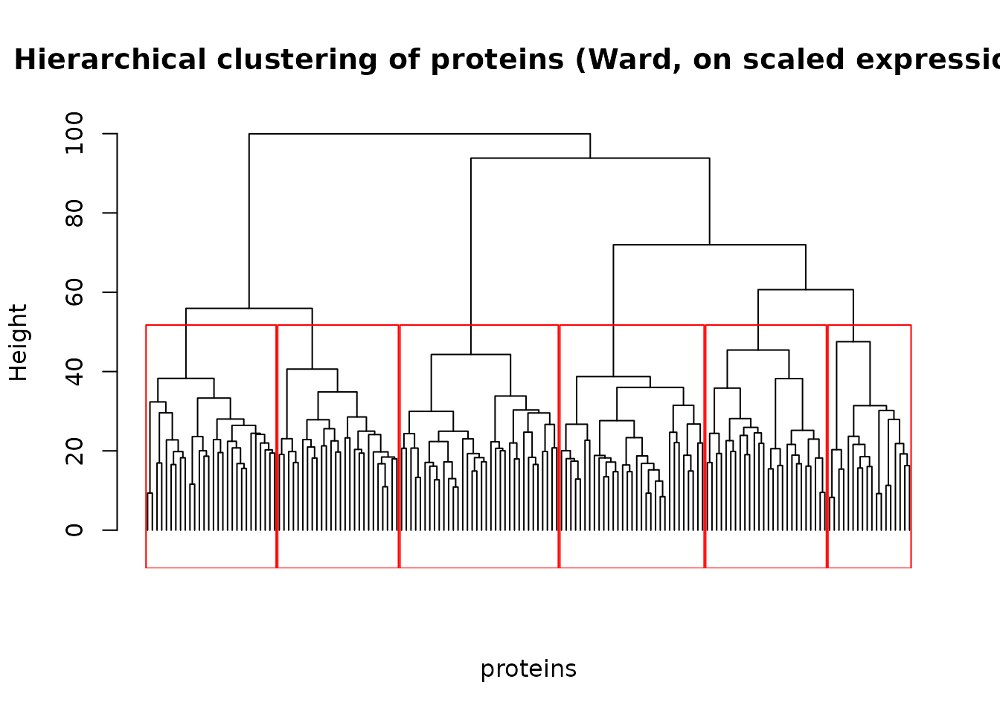
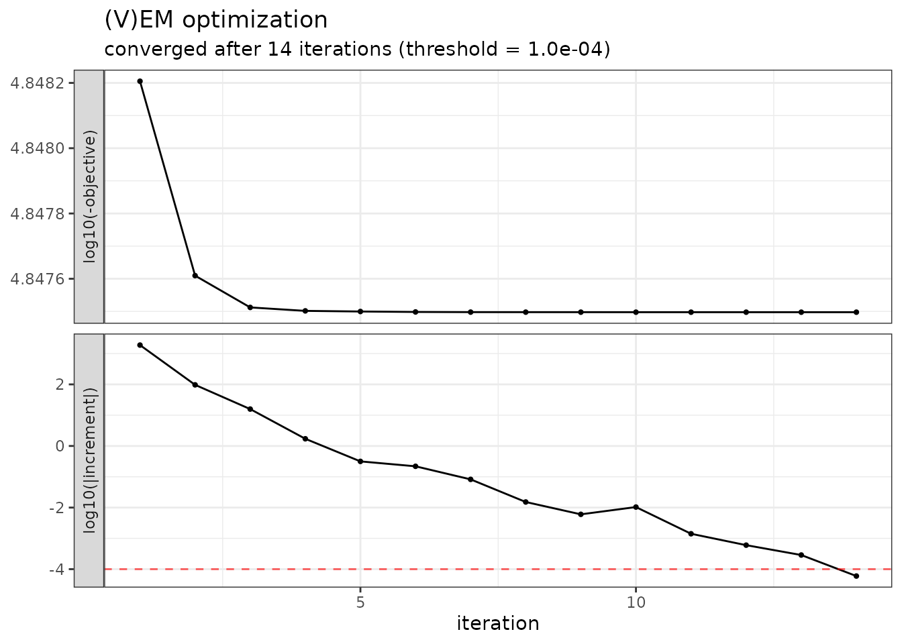
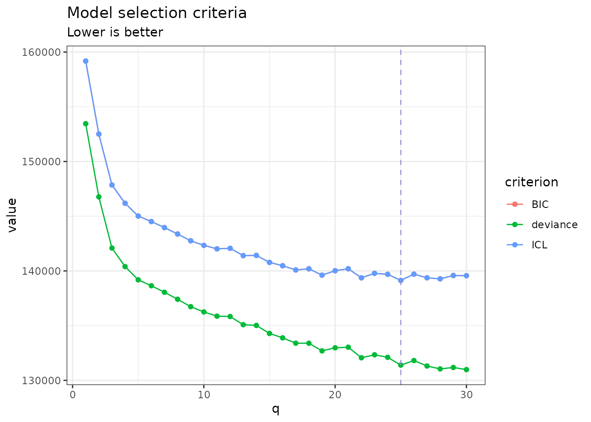
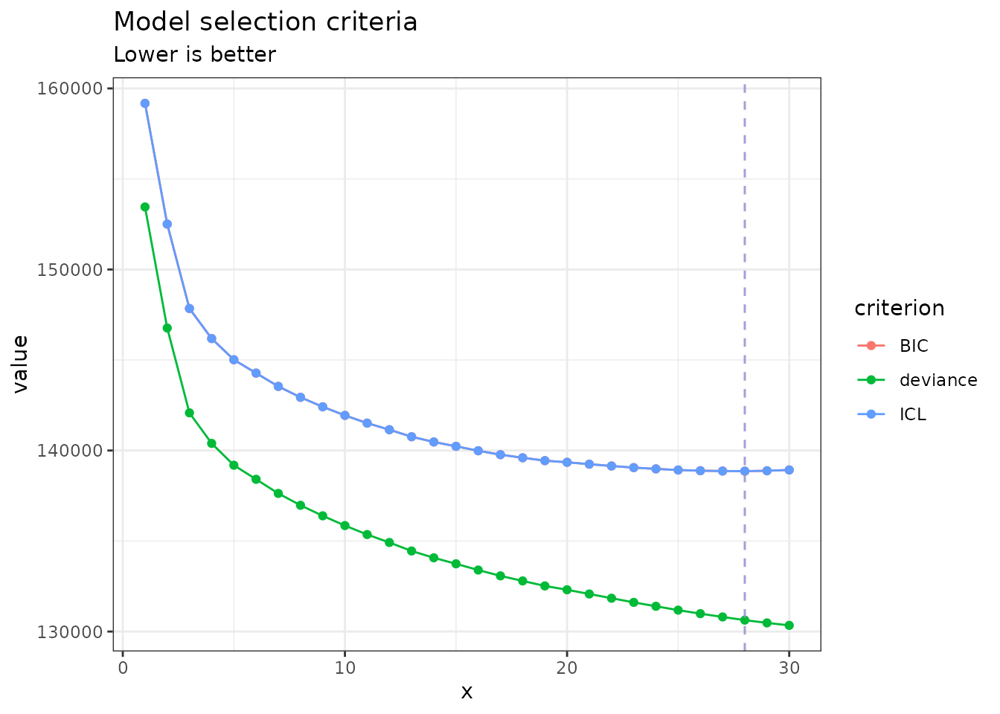
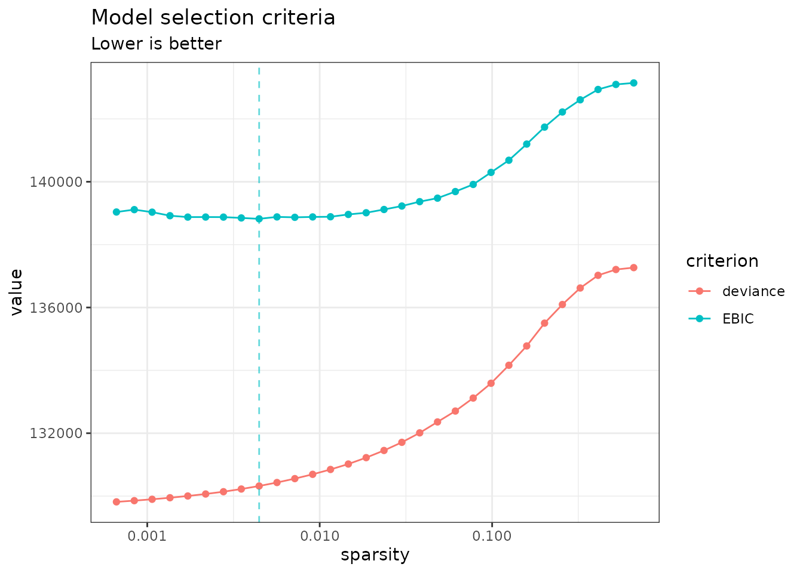

# Normal-Block models: clustering variables by their covariance — a worked example with breast cancer proteomics data

## Preliminaries

This vignette walks through a real-data analysis with the Normal-Block
model, using the `brca_rppa` dataset shipped with the package (see
[`?brca_rppa`](https://jchiquet.github.io/normalblockr/reference/brca_rppa.md)):
reverse-phase protein array measurements of 163 proteins across 346
breast cancer tumor samples from The Cancer Genome Atlas, together with
each sample’s PAM50 molecular subtype. See the `normal-block` vignette
([`vignette("normal-block")`](https://jchiquet.github.io/normalblockr/articles/normal-block.md))
for a general introduction to the package on simulated data; this one
focuses on a single real dataset, illustrated first with a known
clustering of the proteins, then with the clustering left for the model
to infer, and finally with the post-hoc `refine()` step.[^1]

#### Requirements

``` r

library(normalblockr)
```

## Mathematical background

The Normal-Block model is a Gaussian latent-variable model for a table
of observations $`Y \in \mathbb{R}^{n \times p}`$ (here, $`n`$ tumor
samples and $`p`$ proteins), possibly after correcting for covariates
$`X \in \mathbb{R}^{n \times d}`$ (here, the PAM50 subtype).
Conditionally on $`q`$ latent factors $`W_i \in \mathbb{R}^q`$, one per
cluster of variables:

``` math
\begin{aligned}
\text{latent space:} \quad & W_i \sim \mathcal{N}(0, \Omega^{-1}) \\
\text{observation space:} \quad & Y_i \mid W_i \sim \mathcal{N}(C W_i + B^\top X_i,\ D)
\end{aligned}
```

$`C \in \{0,1\}^{p \times q}`$ assigns every protein to exactly one of
the $`q`$ clusters; it is either given (known clustering, e.g. from an
independent source) or itself unknown and inferred jointly with
everything else, in which case the model carries a variational posterior
distribution over $`C`$ rather than a single point estimate. $`D`$ is
the residual (idiosyncratic) covariance of each protein, taken diagonal
here. The key structural assumption is that two proteins in the same
cluster share the *same* latent factor: their covariance is driven
entirely by $`\mathrm{Var}(W_k) = (\Omega^{-1})_{kk}`$, a single value
for the whole cluster, rather than by a separate pairwise term for every
pair of proteins. $`\Omega`$, the latent factors’ precision matrix, is
what `plot_network()` displays: the inferred association network
*between clusters*, not between individual proteins. In its plain
(non-regularized) form, that network is dense and not very informative
to look at directly – we only visualize it at the end of this vignette,
after regularizing it with a graphical lasso penalty. See Tous and
Chiquet (2026) for the model itself and for the full estimation details.

## The data

``` r

data(brca_rppa)
dim(brca_rppa$expr)
#> [1] 346 163
table(brca_rppa$covariates$PAM50_SUBTYPE)
#> 
#>    Basal-like HER2-enriched     Luminal A     Luminal B   Normal-like 
#>            66            43           150            82             5
```

`expr` is the $`346 \times 163`$ matrix of (samples x proteins)
expression levels; the PAM50 subtype, a 5-level clinical covariate, is
used as $`X`$ throughout, so that the model accounts for each subtype’s
own mean expression level before looking for structure in what’s left.

``` r

Y            <- as.matrix(brca_rppa$expr)
X_subtype    <- model.matrix(~ 0 + PAM50_SUBTYPE, data = brca_rppa$covariates)
data_subtype <- NormalBlockData$new(Y, X_subtype)
```

## A known clustering of the proteins

Before letting the Normal-Block model infer its own grouping of the
proteins, we build a simple, fully data-driven baseline: a hierarchical
(Ward) clustering of the proteins from their expression profiles alone,
with no reference to the Normal-Block model at all. By default
`normalblockr` scales the data for variance-block models (each protein
divided by its own standard deviation), so this a priori clustering is
computed on the same (column-)scaled matrix for consistency. Six
clusters is an arbitrary but visually natural cut of the dendrogram.

``` r

hc_expr <- brca_rppa$expr |> scale() |> t() |> dist() |> hclust("ward.D2")
plot(hc_expr, labels = FALSE, hang = -1,
     main = "Hierarchical clustering of proteins (Ward, on scaled expression)",
     xlab = "proteins", sub = "")
rect.hclust(hc_expr, k = 6, border = "red")
```



``` r

group <- model.matrix(~ 0 + factor(cutree(hc_expr, 6)))
```

This fixed grouping is then handed to
[`normal_block()`](https://jchiquet.github.io/normalblockr/reference/normal_block.md)
as a known clustering: the model only estimates the association network
between the 6 blocks, not the grouping itself.

``` r

NB_prot_group <- normal_block(data_subtype, blocks = group)
#> Fitting a diagonal normal-block-var model with fixed clusters 
#> 
#> DONE
plot(NB_prot_group)
```



``` r

print(NB_prot_group)
#> A diagonal normal-block-var model with fixed clusters.
#> ===========================================================================
#>  nb_param q n_edges sparsity    loglik deviance      BIC      ICL   EBIC niter
#>       999 6      15        0 -70387.84 140775.7 146616.3 146616.3 146670    14
#> ===========================================================================
#> * Useful fields
#>     $model_par, $posterior_par / $var_par, $clustering 
#>     $loglik, $BIC, $ICL, $objective, $nb_param, $criteria
#> * Useful S3 methods
#>     print(), summary(), plot(), coef(), sigma(), fitted(), predict()
```

A known clustering should be checked against one property of the model:
within a block, two variables are noisy copies of the same latent
signal, so their correlation is necessarily positive. A block gathering
anticorrelated proteins is misspecified, and would be better described
as two blocks linked by a negative association.
`within_block_correlations()` compares, block by block, the empirical
correlations of the residuals with the ones the fitted model implies:

``` r

NB_prot_group$within_block_correlations()
#>   block size   mean_cor    min_cor prop_negative model_cor
#> 1     1   18 0.23721985 -0.2016547    0.14379085 0.2679674
#> 2     2   34 0.27230730 -0.1436343    0.05882353 0.3422232
#> 3     3   31 0.33595194 -0.2609743    0.06666667 0.4367069
#> 4     4   26 0.10972075 -0.2547531    0.22769231 0.1277935
#> 5     5   28 0.24108436 -0.2079646    0.03968254 0.2729286
#> 6     6   26 0.08398501 -0.3428242    0.34461538 0.1089980
```

## Letting the model infer its own clustering

### Fitting a collection over a range of cluster counts

When the clustering is left unknown,
[`normal_block()`](https://jchiquet.github.io/normalblockr/reference/normal_block.md)
accepts a range of candidate cluster counts and returns a collection of
models, one per $`q`$, fitted independently, each cold-started from a
clustering heuristic on the residuals (`kmeans` by default), then
polished by `refine()` (see below). We turn `refine()` off here, to show
what it changes in the next section.[^2]

``` r

NB_prot_subtype <- normal_block(data_subtype, blocks = 1:30, control = NB_control(refine = FALSE))
#> Fitting a collection of diagonal normal-block-var models over q 
#> 
#> DONE
```

### Model selection: criteria to fix the number of clusters

``` r

NB_prot_subtype$plot(c("deviance", "BIC", "ICL"))
```



``` r

selected_NB <- NB_prot_subtype$get_best_model("ICL")
paste0("ICL selects ", selected_NB$q, " clusters.")
#> [1] "ICL selects 25 clusters."
```

## Refining the clustering

Every model in the collection above was fitted independently,
cold-started from its own clustering heuristic: on real data, it can
settle into a milder local optimum than an incremental, neighbor-seeded
search would. `refine()` tries, for every $`q`$ beyond the collection’s
extremes, a short split-and-reoptimize trial seeded from its
already-fitted $`q-1`$ neighbor and/or a short merge-and-reoptimize
trial seeded from its $`q+1`$ neighbor, keeping a candidate only if it
strictly improves the deviance. It runs unconditionally over the whole
range and discards whatever doesn’t help, so it can only improve (or
leave unchanged) each model it touches.
[`normal_block()`](https://jchiquet.github.io/normalblockr/reference/normal_block.md)
runs it by default (`NB_control(refine = TRUE)`); since we turned it off
above, we call it explicitly:

``` r

NB_prot_subtype$refine()
#>   refine: q = 2 -- deviance 146766.1 -> 146766.1 (improved via split )
#>   refine: q = 3 -- deviance 142087.1 -> 142087.1 (improved via split )
#>   refine: q = 4 -- no improvement found ( split )
#>   refine: q = 5 -- no improvement found ( split )
#>   refine: q = 6 -- deviance 138644.3 -> 138409.3 (improved via split )
#>   refine: q = 7 -- deviance 138047.7 -> 137629 (improved via split )
#>   refine: q = 8 -- deviance 137409.7 -> 137107.1 (improved via split )
#>   refine: q = 9 -- deviance 136731 -> 136672.8 (improved via split )
#>   refine: q = 10 -- no improvement found ( split )
#>   refine: q = 11 -- deviance 135864.5 -> 135493.1 (improved via split )
#>   refine: q = 12 -- deviance 135833.7 -> 135157.5 (improved via split )
#>   refine: q = 13 -- deviance 135087 -> 134873.9 (improved via split )
#>   refine: q = 14 -- deviance 135019.4 -> 134669.1 (improved via split )
#>   refine: q = 15 -- deviance 134286.7 -> 134048.9 (improved via split )
#>   refine: q = 16 -- deviance 133884.8 -> 133765.4 (improved via split )
#>   refine: q = 17 -- deviance 133394.8 -> 133255.6 (improved via split )
#>   refine: q = 18 -- deviance 133391.2 -> 133054.4 (improved via split )
#>   refine: q = 19 -- no improvement found ( split )
#>   refine: q = 20 -- deviance 132974.8 -> 132465.9 (improved via split )
#>   refine: q = 21 -- deviance 133028.7 -> 132257.8 (improved via split )
#>   refine: q = 22 -- deviance 132062 -> 132020 (improved via split )
#>   refine: q = 23 -- deviance 132335.8 -> 131777.5 (improved via split )
#>   refine: q = 24 -- deviance 132104.2 -> 131602.6 (improved via split )
#>   refine: q = 25 -- deviance 131391.5 -> 131380.4 (improved via split )
#>   refine: q = 26 -- deviance 131808.2 -> 131231.8 (improved via split )
#>   refine: q = 27 -- deviance 131309.7 -> 130914 (improved via split )
#>   refine: q = 28 -- deviance 131045.1 -> 130743 (improved via split )
#>   refine: q = 29 -- deviance 131177.5 -> 130542.6 (improved via split )
#>   refine: q = 30 -- deviance 130980.4 -> 130341.2 (improved via split )
#>   refine: q = 29 -- deviance 130542.6 -> 130477.2 (improved via merge )
#>   refine: q = 28 -- deviance 130743 -> 130631 (improved via merge )
#>   refine: q = 27 -- deviance 130914 -> 130805.7 (improved via merge )
#>   refine: q = 26 -- deviance 131231.8 -> 130987.5 (improved via merge )
#>   refine: q = 25 -- deviance 131380.4 -> 131182.1 (improved via merge )
#>   refine: q = 24 -- deviance 131602.6 -> 131395.6 (improved via merge )
#>   refine: q = 23 -- deviance 131777.5 -> 131611.1 (improved via merge )
#>   refine: q = 22 -- deviance 132020 -> 131840.7 (improved via merge )
#>   refine: q = 21 -- deviance 132257.8 -> 132075 (improved via merge )
#>   refine: q = 20 -- deviance 132465.9 -> 132307.1 (improved via merge )
#>   refine: q = 19 -- deviance 132692.6 -> 132519.5 (improved via merge )
#>   refine: q = 18 -- deviance 133054.4 -> 132795.2 (improved via merge )
#>   refine: q = 17 -- deviance 133255.6 -> 133075.5 (improved via merge )
#>   refine: q = 16 -- deviance 133765.4 -> 133397.1 (improved via merge )
#>   refine: q = 15 -- deviance 134048.9 -> 133741.5 (improved via merge )
#>   refine: q = 14 -- deviance 134669.1 -> 134073.5 (improved via merge )
#>   refine: q = 13 -- deviance 134873.9 -> 134449.5 (improved via merge )
#>   refine: q = 12 -- deviance 135157.5 -> 134918.9 (improved via merge )
#>   refine: q = 11 -- deviance 135493.1 -> 135357.8 (improved via merge )
#>   refine: q = 10 -- deviance 136250.3 -> 135853.7 (improved via merge )
#>   refine: q = 9 -- deviance 136672.8 -> 136391.9 (improved via merge )
#>   refine: q = 8 -- deviance 137107.1 -> 136974.8 (improved via merge )
#>   refine: q = 7 -- no improvement found ( merge )
#>   refine: q = 6 -- no improvement found ( merge )
#>   refine: q = 5 -- no improvement found ( merge )
#>   refine: q = 4 -- no improvement found ( merge )
#>   refine: q = 3 -- deviance 142087.1 -> 142080.9 (improved via merge )
#>   refine: q = 2 -- no improvement found ( merge )
#>   refine: q = 1 -- no improvement found ( merge )
```

``` r

NB_prot_subtype$plot(c("deviance", "BIC", "ICL"))
```



``` r

selected_NB_refined <- NB_prot_subtype$get_best_model("ICL")
paste0("After refine(), ICL selects ", selected_NB_refined$q, " clusters.")
#> [1] "After refine(), ICL selects 28 clusters."
```

On this dataset, `refine()` moves the ICL-selected number of clusters, a
reminder that the collection-wide local search is not just cosmetic: a
clustering that looked locally optimal in isolation can still be
improved once its neighbors in $`q`$ are available as alternative
starting points.

## Sparsifying the network of the selected clustering

The association network $`\Omega`$ of the ICL-selected model above is
dense (no penalty was applied), which makes it hard to read directly.
Treating that clustering as fixed, we refit the model with the
graphical-lasso penalty on $`\Omega`$ explored over a path of values
(`sparsity = TRUE`). Along such a path, some fits may stop at the
iteration cap with a warning; they are not shown here.

``` r

group_selected <- model.matrix(~ 0 + factor(selected_NB_refined$clustering))
NB_prot_sparse <- normal_block(data_subtype, blocks = group_selected, sparsity = TRUE,
                               control = NB_control(min_ratio = 0.001, verbose = FALSE))
```

``` r

plot(NB_prot_sparse, c("EBIC", "deviance"))
```



The criteria favour weak penalties, hence dense networks: the EBIC keeps
many of the possible edges.

``` r

sparse_ebic <- NB_prot_sparse$get_best_model("EBIC")
paste0("EBIC keeps ", sparse_ebic$n_edges, " edges out of ", choose(sparse_ebic$q, 2), ".")
#> [1] "EBIC keeps 180 edges out of 378."
```

Stability selection (StARS) is better suited to reading the network. It
refits the path on subsamples of the observations, the clustering being
held fixed, and keeps the smallest penalty whose network is stable
enough:

``` r

set.seed(1)
sparse_stars <- NB_prot_sparse$get_best_model("StARS")
paste0("StARS keeps ", sparse_stars$n_edges, " edges.")
#> [1] "StARS keeps 51 edges."
```

``` r

sparse_stars$plot_network(node.labels = seq_len(sparse_stars$q), remove.isolated = TRUE,
                          layout = igraph::layout_with_fr)
```


The width of an edge is proportional to the absolute partial correlation
between the two clusters, positive in red and negative in turquoise, and
the size of a node to that of its cluster; isolated clusters are not
drawn.

## References

Tous, Jeanne, and Julien Chiquet. 2026. “An Integrated Method for
Clustering and Association Network Inference.” *Computational Statistics
& Data Analysis* 219: 108347.
<https://doi.org/10.1016/j.csda.2026.108347>.

[^1]: This dataset is also the running example of Tous and Chiquet
    (2026), which includes a biological-enrichment analysis of the
    inferred clusters (`enrichKEGG`/`compareCluster`, via
    `clusterProfiler`) – not reproduced here, since it pulls in several
    heavy Bioconductor dependencies and network queries; see
    `inst/CSDA_analyses/analysis_breast_cancer_proteomics.qmd` in the
    package sources for the full analysis, enrichment included.

[^2]: Different heuristics can converge to substantially different (V)EM
    local optima at the same $`q`$;
    `NB_control(clustering_init = "best_of_inits")` tries several and
    keeps the best-ELBO fit, at extra cost. Worth it when `refine()` is
    turned off, but on this dataset’s full range `refine()` alone
    already recovers what it would add.
