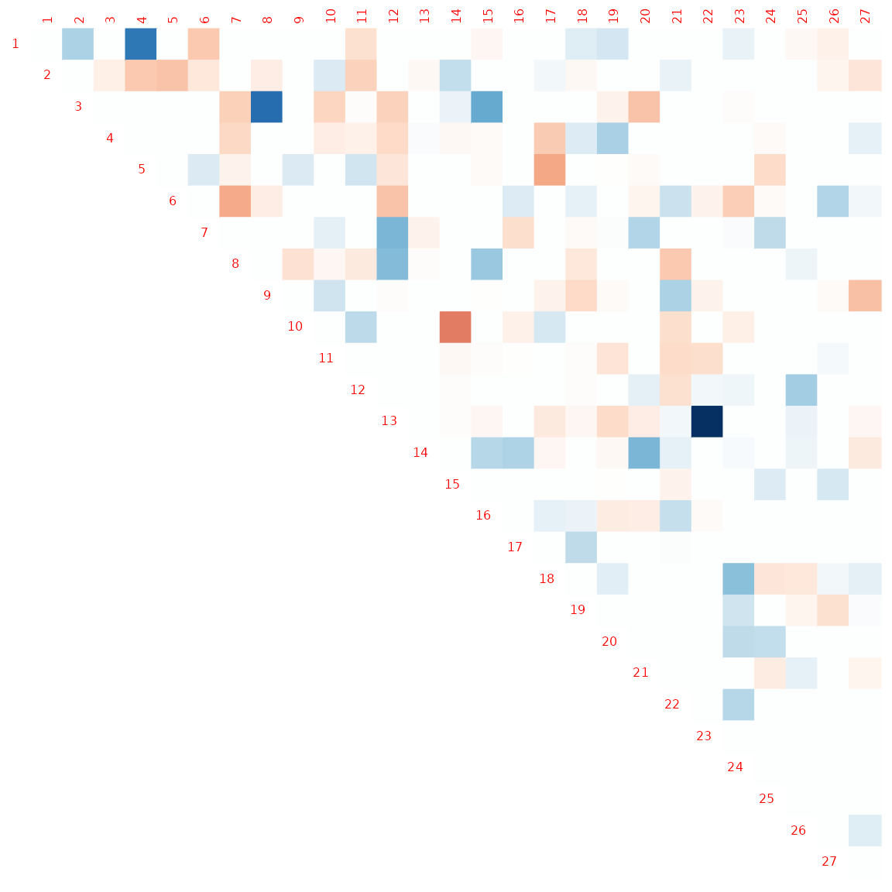

# Normal-Block models: clustering variables by their covariance -- a worked example with breast cancer proteomics data

## Preliminaries

This vignette walks through a real-data analysis with the Normal-Block
model, using the `brca_rppa` dataset shipped with the package (see
[`?brca_rppa`](../reference/brca_rppa.md)): reverse-phase protein array
measurements of 163 proteins across 346 breast cancer tumor samples from
The Cancer Genome Atlas, together with each sample’s PAM50 molecular
subtype. See the `normal-block` vignette
([`vignette("normal-block")`](../articles/normal-block.md)) for a
general introduction to the package on simulated data; this one focuses
on a single real dataset, illustrated first with a known clustering of
the proteins, then with the clustering left for the model to infer, and
finally with the post-hoc `refine()` step.[^1]

#### Requirements

``` r

library(normalblockr)
```

## Mathematical background

The Normal-Block model is a Gaussian latent-variable model for a table
of observations $`Y \in \mathbb{R}^{n \times p}`$ (here, $`n`$ tumor
samples and $`p`$ proteins), possibly after correcting for covariates
$`X \in \mathbb{R}^{n \times d}`$ (here, the PAM50 subtype).
Conditionally on $`q`$ latent factors $`W_i \in \mathbb{R}^q`$, one per
cluster of variables:

``` math
\begin{aligned}
\text{latent space:} \quad & W_i \sim \mathcal{N}(0, \Omega^{-1}) \\
\text{observation space:} \quad & Y_i \mid W_i \sim \mathcal{N}(C W_i + B^\top X_i,\ D)
\end{aligned}
```

$`C \in \{0,1\}^{p \times q}`$ assigns every protein to exactly one of
the $`q`$ clusters; it is either given (known clustering, e.g. from an
independent source) or itself unknown and inferred jointly with
everything else, in which case the model carries a variational posterior
distribution over $`C`$ rather than a single point estimate. $`D`$ is
the residual (idiosyncratic) covariance of each protein, taken diagonal
here. The key structural assumption is that two proteins in the same
cluster share the *same* latent factor: their covariance is driven
entirely by $`\mathrm{Var}(W_k) = (\Omega^{-1})_{kk}`$, a single value
for the whole cluster, rather than by a separate pairwise term for every
pair of proteins. $`\Omega`$, the latent factors’ precision matrix, is
what `plot_network()` displays: the inferred association network
*between clusters*, not between individual proteins. In its plain
(non-regularized) form, that network is dense and not very informative
to look at directly – we only visualize it at the end of this vignette,
after regularizing it with a graphical lasso penalty. See Tous and
Chiquet (2026) for the model itself and for the full estimation details.

## The data

``` r

data(brca_rppa)
dim(brca_rppa$expr)
#> [1] 346 163
table(brca_rppa$covariates$PAM50_SUBTYPE)
#> 
#>    Basal-like HER2-enriched     Luminal A     Luminal B   Normal-like 
#>            66            43           150            82             5
```

`expr` is the $`346 \times 163`$ matrix of (samples x proteins)
expression levels; the PAM50 subtype, a 5-level clinical covariate, is
used as $`X`$ throughout, so that the model accounts for each subtype’s
own mean expression level before looking for structure in what’s left.

``` r

Y            <- as.matrix(brca_rppa$expr)
X_subtype    <- model.matrix(~ 0 + PAM50_SUBTYPE, data = brca_rppa$covariates)
data_subtype <- NormalBlockData$new(Y, X_subtype)
```

## A known clustering of the proteins

Before letting the Normal-Block model infer its own grouping of the
proteins, we build a simple, fully data-driven baseline: a hierarchical
(Ward) clustering of the proteins from their expression profiles alone,
with no reference to the Normal-Block model at all. By default
`normalblockr` scales the data, so this a priori clustering is computed
on the same (column-)scaled matrix for consistency. Six clusters is an
arbitrary but visually natural cut of the dendrogram.

``` r

hc_expr <- brca_rppa$expr |> scale() |> t() |> dist() |> hclust("ward.D2")
plot(hc_expr, labels = FALSE, hang = -1,
     main = "Hierarchical clustering of proteins (Ward, on scaled expression)",
     xlab = "proteins", sub = "")
rect.hclust(hc_expr, k = 6, border = "red")
```


``` r

group <- cutree(hc_expr, 6) |> normalblockr:::as_indicator()
```

This fixed grouping is then handed to
[`normal_block()`](../reference/normal_block.md) as a known clustering:
the model only estimates the association network between the 6 blocks,
not the grouping itself.

``` r

NB_prot_group <- normal_block(data_subtype, blocks = group)
#> Fitting a diagonal normal-block-var model with fixed blocks 
#> 
#> DONE
plot(NB_prot_group)
```


``` r

print(NB_prot_group)
#> A diagonal normal-block-var model with fixed blocks .
#> ===========================================================================
#>  nb_param q n_edges sparsity    loglik deviance      BIC      ICL   EBIC niter
#>       999 6      15        0 -70387.84 140775.7 146616.3 146616.3 146670    14
#> ===========================================================================
#> * Useful fields
#>     $model_par, $posterior_par / $var_par, $clustering 
#>     $loglik, $BIC, $ICL, $objective, $nb_param, $criteria
#> * Useful S3 methods
#>     print(), summary(), plot(), coef(), sigma(), fitted(), predict()
```

## Letting the model infer its own clustering

### Fitting a collection over a range of cluster counts

When the clustering is left unknown,
[`normal_block()`](../reference/normal_block.md) accepts a range of
candidate cluster counts and returns a collection of models, one per
$`q`$, fitted independently, each cold-started from a clustering
heuristic on the residuals (`ward2` by default).[^2]

``` r

NB_prot_subtype <- normal_block(data_subtype, blocks = 1:30)
#> Fitting a diagonal normal-block-var model with unknown q 
#>   number of blocks = 1                number of blocks = 2                number of blocks = 3                number of blocks = 4                number of blocks = 5                number of blocks = 6                number of blocks = 7                number of blocks = 8                number of blocks = 9                number of blocks = 10               number of blocks = 11               number of blocks = 12               number of blocks = 13               number of blocks = 14               number of blocks = 15               number of blocks = 16               number of blocks = 17               number of blocks = 18               number of blocks = 19               number of blocks = 20               number of blocks = 21               number of blocks = 22               number of blocks = 23               number of blocks = 24               number of blocks = 25               number of blocks = 26               number of blocks = 27               number of blocks = 28               number of blocks = 29               number of blocks = 30           
#> DONE
```

### Model selection: criteria to fix the number of clusters

``` r

NB_prot_subtype$plot(c("deviance", "BIC", "ICL"))
```


``` r

selected_NB <- NB_prot_subtype$get_best_model("ICL")
paste0("ICL selects ", selected_NB$q, " clusters.")
#> [1] "ICL selects 27 clusters."
```

## Refining the clustering

Every model in the collection above was fitted independently,
cold-started from its own clustering heuristic: on real data, it can
settle into a milder local optimum than an incremental, neighbor-seeded
search would. `refine()` tries, for every $`q`$ beyond the collection’s
extremes, a short split-and-reoptimize trial seeded from its
already-fitted $`q-1`$ neighbor and/or a short merge-and-reoptimize
trial seeded from its $`q+1`$ neighbor, keeping a candidate only if it
strictly improves the deviance. It runs unconditionally over the whole
range and discards whatever doesn’t help, so it can only improve (or
leave unchanged) each model it touches.

``` r

NB_prot_subtype$refine()
#>   refine: q = 2 -- deviance 146766.1 -> 146766.1 (improved via split )
#>   refine: q = 3 -- deviance 142087.1 -> 142087.1 (improved via split )
#>   refine: q = 4 -- no improvement found ( split )
#>   refine: q = 5 -- no improvement found ( split )
#>   refine: q = 6 -- deviance 138548.1 -> 138409.3 (improved via split )
#>   refine: q = 7 -- deviance 137802.5 -> 137629 (improved via split )
#>   refine: q = 8 -- no improvement found ( split )
#>   refine: q = 9 -- no improvement found ( split )
#>   refine: q = 10 -- no improvement found ( split )
#>   refine: q = 11 -- no improvement found ( split )
#>   refine: q = 12 -- deviance 135679.5 -> 135617 (improved via split )
#>   refine: q = 13 -- deviance 135413.1 -> 135323.2 (improved via split )
#>   refine: q = 14 -- deviance 135242.5 -> 134745.8 (improved via split )
#>   refine: q = 15 -- deviance 135159 -> 134481.4 (improved via split )
#>   refine: q = 16 -- deviance 134925.2 -> 134204.1 (improved via split )
#>   refine: q = 17 -- deviance 134716 -> 134007.7 (improved via split )
#>   refine: q = 18 -- deviance 134556 -> 133866 (improved via split )
#>   refine: q = 19 -- deviance 134474 -> 133396.9 (improved via split )
#>   refine: q = 20 -- deviance 134390.4 -> 133069.9 (improved via split )
#>   refine: q = 21 -- deviance 133657 -> 132901.5 (improved via split )
#>   refine: q = 22 -- deviance 133386.1 -> 132693.7 (improved via split )
#>   refine: q = 23 -- deviance 133032.2 -> 132493.8 (improved via split )
#>   refine: q = 24 -- deviance 132876.8 -> 132117.1 (improved via split )
#>   refine: q = 25 -- deviance 132833.9 -> 131966.6 (improved via split )
#>   refine: q = 26 -- deviance 132714.6 -> 131810.2 (improved via split )
#>   refine: q = 27 -- deviance 132248.1 -> 131693.7 (improved via split )
#>   refine: q = 28 -- deviance 132100.6 -> 131565.2 (improved via split )
#>   refine: q = 29 -- deviance 132026 -> 131411.8 (improved via split )
#>   refine: q = 30 -- deviance 131826.3 -> 131099.6 (improved via split )
#>   refine: q = 29 -- deviance 131411.8 -> 131253.5 (improved via merge )
#>   refine: q = 28 -- deviance 131565.2 -> 131430.8 (improved via merge )
#>   refine: q = 27 -- deviance 131693.7 -> 131487 (improved via merge )
#>   refine: q = 26 -- deviance 131810.2 -> 131664.6 (improved via merge )
#>   refine: q = 25 -- deviance 131966.6 -> 131819.6 (improved via merge )
#>   refine: q = 24 -- deviance 132117.1 -> 131996.6 (improved via merge )
#>   refine: q = 23 -- deviance 132493.8 -> 132155.4 (improved via merge )
#>   refine: q = 22 -- deviance 132693.7 -> 132355.2 (improved via merge )
#>   refine: q = 21 -- deviance 132901.5 -> 132570.1 (improved via merge )
#>   refine: q = 20 -- deviance 133069.9 -> 132730 (improved via merge )
#>   refine: q = 19 -- deviance 133396.9 -> 132936.9 (improved via merge )
#>   refine: q = 18 -- deviance 133866 -> 133157.8 (improved via merge )
#>   refine: q = 17 -- deviance 134007.7 -> 133349.3 (improved via merge )
#>   refine: q = 16 -- deviance 134204.1 -> 133628.1 (improved via merge )
#>   refine: q = 15 -- deviance 134481.4 -> 133903.8 (improved via merge )
#>   refine: q = 14 -- deviance 134745.8 -> 134229.2 (improved via merge )
#>   refine: q = 13 -- deviance 135323.2 -> 134640.8 (improved via merge )
#>   refine: q = 12 -- deviance 135617 -> 135026.4 (improved via merge )
#>   refine: q = 11 -- deviance 135862.7 -> 135434.9 (improved via merge )
#>   refine: q = 10 -- deviance 136359.2 -> 135851.8 (improved via merge )
#>   refine: q = 9 -- deviance 136709.9 -> 136404.3 (improved via merge )
#>   refine: q = 8 -- deviance 137071.8 -> 136920.9 (improved via merge )
#>   refine: q = 7 -- no improvement found ( merge )
#>   refine: q = 6 -- no improvement found ( merge )
#>   refine: q = 5 -- deviance 139187.3 -> 139187.3 (improved via merge )
#>   refine: q = 4 -- deviance 140446 -> 140393.1 (improved via merge )
#>   refine: q = 3 -- deviance 142087.1 -> 142080.9 (improved via merge )
#>   refine: q = 2 -- no improvement found ( merge )
#>   refine: q = 1 -- no improvement found ( merge )
```

``` r

NB_prot_subtype$plot(c("deviance", "BIC", "ICL"))
```


``` r

selected_NB_refined <- NB_prot_subtype$get_best_model("ICL")
paste0("After refine(), ICL selects ", selected_NB_refined$q, " clusters.")
#> [1] "After refine(), ICL selects 27 clusters."
```

On this dataset, `refine()` moves the ICL-selected number of clusters, a
reminder that the collection-wide local search is not just cosmetic: a
clustering that looked locally optimal in isolation can still be
improved once its neighbors in $`q`$ are available as alternative
starting points.

## Sparsifying the network of the selected clustering

The association network $`\Omega`$ of the ICL-selected model above is
dense (no penalty was applied), which makes it hard to read directly.
Treating that clustering as fixed, we can refit the model once more with
the graphical-lasso penalty on $`\Omega`$ explored over a path of values
(`sparsity = TRUE`), and pick the sparsity level with the best BIC.

``` r

group_selected <- selected_NB_refined$clustering |> normalblockr:::as_indicator()
NB_prot_sparse <- normal_block(data_subtype, blocks = group_selected, sparsity = TRUE, control = NB_control(min_ratio=0.001))
#> Fitting a Collection of diagonal normal-block-var models with fixed blocks, with different sparsity penalties. 
#>   penalty = 0.5081954             penalty = 0.4004815             penalty = 0.315598              penalty = 0.2487058             penalty = 0.1959917             penalty = 0.1544505           
#> Warning: diagonal normal-block-var model with fixed blocks: (V)EM stopped at
#> the niter cap (500) without reaching the convergence threshold (last increment
#> = 0.000535, threshold = 1.0e-04). Consider raising `niter` in NB_control(),
#> especially with many blocks -- see plot_loglik() to check.
#>   penalty = 0.1217142           
#> Warning: diagonal normal-block-var model with fixed blocks: (V)EM stopped at
#> the niter cap (500) without reaching the convergence threshold (last increment
#> = 0.000981, threshold = 1.0e-04). Consider raising `niter` in NB_control(),
#> especially with many blocks -- see plot_loglik() to check.
#>   penalty = 0.09591639           
#> Warning: diagonal normal-block-var model with fixed blocks: (V)EM stopped at
#> the niter cap (500) without reaching the convergence threshold (last increment
#> = 0.000623, threshold = 1.0e-04). Consider raising `niter` in NB_control(),
#> especially with many blocks -- see plot_loglik() to check.
#>   penalty = 0.07558655           
#> Warning: diagonal normal-block-var model with fixed blocks: (V)EM stopped at
#> the niter cap (500) without reaching the convergence threshold (last increment
#> = 0.000326, threshold = 1.0e-04). Consider raising `niter` in NB_control(),
#> especially with many blocks -- see plot_loglik() to check.
#>   penalty = 0.0595657             penalty = 0.04694053                penalty = 0.03699131                penalty = 0.02915087                penalty = 0.02297223                penalty = 0.01810318                penalty = 0.01426614                penalty = 0.01124238                penalty = 0.008859517               penalty = 0.00698171                penalty = 0.00550191                penalty = 0.00433576                penalty = 0.00341678                penalty = 0.00269258                penalty = 0.002121878           
#> Warning: diagonal normal-block-var model with fixed blocks: (V)EM stopped at
#> the niter cap (500) without reaching the convergence threshold (last increment
#> = 0.000459, threshold = 1.0e-04). Consider raising `niter` in NB_control(),
#> especially with many blocks -- see plot_loglik() to check.
#>   penalty = 0.001672138           
#> Warning: diagonal normal-block-var model with fixed blocks: (V)EM stopped at
#> the niter cap (500) without reaching the convergence threshold (last increment
#> = 0.0011, threshold = 1.0e-04). Consider raising `niter` in NB_control(),
#> especially with many blocks -- see plot_loglik() to check.
#>   penalty = 0.001317722               penalty = 0.001038426               penalty = 0.0008183278              penalty = 0.0006448802              penalty = 0.0005081954           
#> DONE
```

``` r

plot(NB_prot_sparse, c("EBIC", "deviance"))
```


``` r

sparse_best <- NB_prot_sparse$get_best_model("EBIC")
paste0("BIC selects a penalty of ", round(sparse_best$sparsity, 4), ".")
#> [1] "BIC selects a penalty of 0.0143."
```

``` r

sparse_best$plot_network(output = "corrplot")
```



## References

Tous, Jeanne, and Julien Chiquet. 2026. “An Integrated Method for
Clustering and Association Network Inference.” *Computational Statistics
& Data Analysis* 219: 108347.
<https://doi.org/10.1016/j.csda.2026.108347>.

[^1]: This dataset is also the running example of Tous and Chiquet
    (2026), which includes a biological-enrichment analysis of the
    inferred clusters (`enrichKEGG`/`compareCluster`, via
    `clusterProfiler`) – not reproduced here, since it pulls in several
    heavy Bioconductor dependencies and network queries; see
    `inst/CSDA_analyses/analysis_breast_cancer_proteomics.qmd` in the
    package sources for the full analysis, enrichment included.

[^2]: Different heuristics can converge to substantially different (V)EM
    local optima at the same $`q`$;
    `NB_control(clustering_init = "best_of_inits")` tries several and
    keeps the best-ELBO fit, at extra cost. Worth it when `refine()`
    (next section) won’t also be applied, but on this dataset’s full
    range `refine()` alone already recovers most of what it would add,
    so we stick with the default here.
