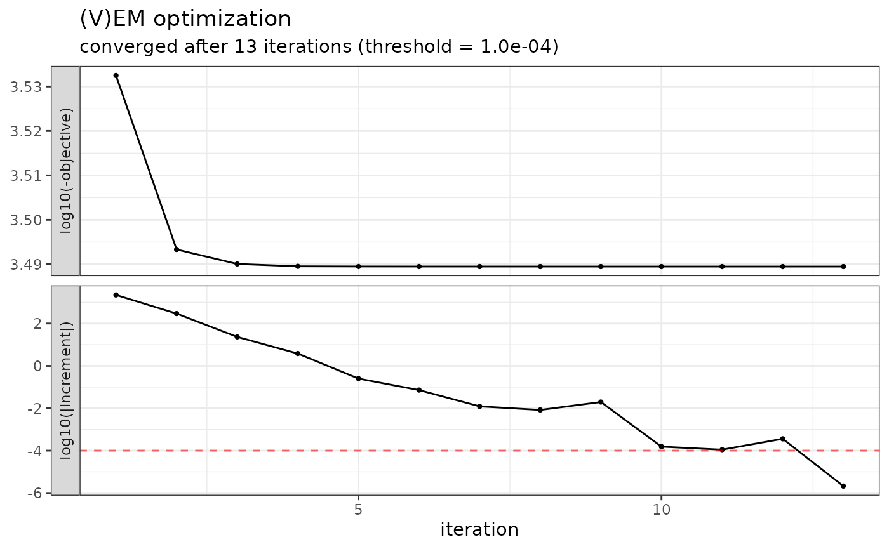
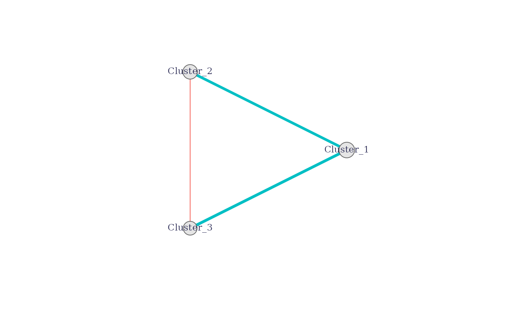
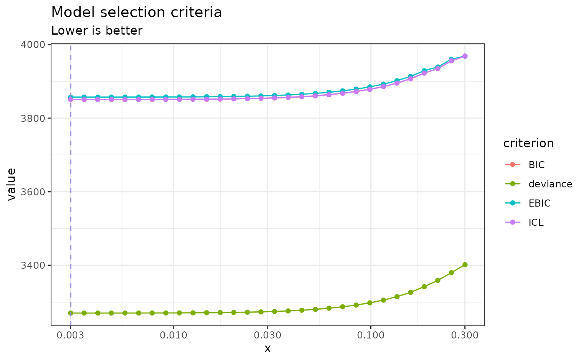
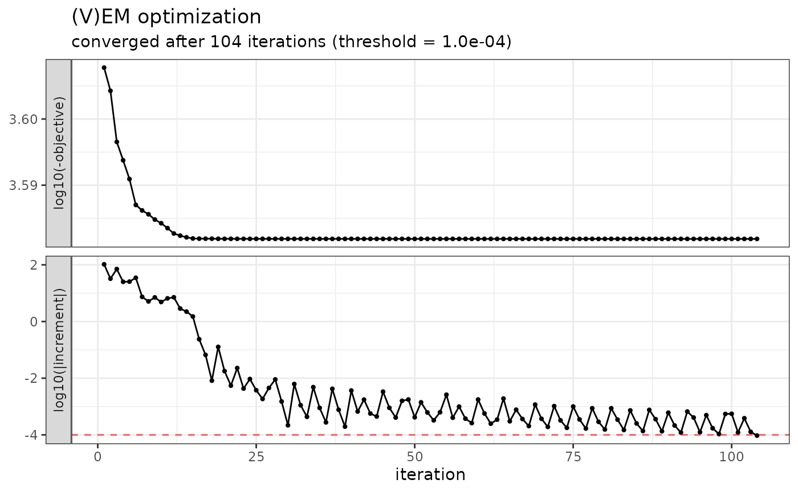

# Analyzing multivariate Gaussian data with the Normal-Block model (variance clustering) - First steps

## Preliminaries

This vignette illustrates the use of the
[`normal_block()`](../reference/normal_block.md) function and the
methods accompanying its R6 classes.

From a statistical point of view, the
[`normal_block()`](../reference/normal_block.md) function fits a
multivariate Normal-Block model (a Gaussian graphical model with a
latent clustering structure) to a table of observations, possibly after
correcting for the effect of covariates. Depending on the arguments
given, the function uses a clustering supplied by the user or infers
one, includes zero-inflation or not, infers a sparse network or not, and
so on. Parameter inference can either be done with an integrated
variational Expectation-Maximization approach (recommended) or with a
faster heuristic approach.

This vignette covers the default family, where the clustering structures
the *covariance* of the variables (`model = "var"`). A complementary
family clusters variables by their *response to covariates* instead
(`model = "mean"`); see
[`vignette("mean-block-breast-cancer")`](../articles/mean-block-breast-cancer.md).

Theoretical explanations for this model and full estimation details
(criteria, E/M updates) can be found in Tous and Chiquet (2026).

#### Requirements

``` r

library(normalblockr)
library(pheatmap)
library(paletteer)
```

## Data simulation

We illustrate the analysis with two simulated datasets.

Fix the seed to make the results reproducible.

``` r

set.seed(1)
```

Simulate data with `generate_normal_block_data()`.

### Fix simulation parameters

Several parameters need to be defined to simulate the data:

``` r

n = 100 # Number of samples (number of rows in the matrix of observations)
p = 40  # Number of entities observed (number of columns in the matrix of observations)
d = 2   # Number of covariates
q = 3   # Number of clusters
kappa = 0 # Mean zero-inflation probability (can also be a vector to define one ZI-probability for each variable). kappa = 0 means that there is no zero-inflation.
omega_structure = "erdos-renyi" # Network structure.
u_v = c(0.3, 0.1) # Parameters to generate an association matrix from a graph, details given in the bibliography.
SNR = 0.75 # Signal to Noise Ratio, defines the relative weight of the covariates and the variance
alpha = rep(1/q, q) # Vector giving probabilities of belonging to each cluster
range_X = c(0, 10)  # Min and max values for the covariates
range_D = c(0.5, 1.5) # Min and max values for the individual entities variances
```

### Simulation 1 (no zero-inflation)

[`generate_normal_block_var_data()`](../reference/generate_normal_block_var_data.md)
generates data under the Normal-Block model. It returns a list
containing the simulated covariates $`X`$ and observations $`Y`$, and
the simulation parameters (including the clustering $`C`$).

``` r

my_nb_data <- generate_normal_block_var_data(n, p, d, q, kappa, omega_structure, u_v,
                                            SNR, alpha, range_X, range_D)
```

``` r

pheatmap::pheatmap(my_nb_data$Y,
                   color =paletteer::paletteer_c("ggthemes::Orange-Gold", n = 100), cluster_rows = FALSE, cluster_cols = FALSE, show_rownames = FALSE)
```


### Simulation 2 (with zero-inflation)

To generate zero-inflated data, we set-up kappa as a vector of
zero-inflation probabilities. One needs to ensure that these values are
between 0 and 1.

``` r

kappa_zi <- rnorm(p, mean = 0.7, sd = 0.05)
kappa_zi <- unlist(lapply(kappa_zi, f <- function(x) return(max(0, min(x, 0.9)))))
my_nb_data_zi <- generate_normal_block_var_data(n = n, p = p, d = d, q = 5, kappa = kappa_zi,
                                                omega_structure = omega_structure, u_v = u_v,
                                                SNR = SNR, alpha = alpha,
                                                range_X = range_X, range_D = range_D)
```

For a better visualization of the zero-inflated data, we set-up the 0 to
be shown in white.

``` r

min_val <- min(my_nb_data_zi$Y) ; max_val <- max(my_nb_data_zi$Y)
orange_gold_pal <- paletteer::paletteer_c("ggthemes::Orange-Gold", n = 100)
n_breaks <- 100
zero_pos <- round((0 - min_val) / (max_val - min_val) * n_breaks) + 1
custom_pal <- c(orange_gold_pal[1:(zero_pos - 1)], "white", orange_gold_pal[zero_pos:n_breaks])
pheatmap::pheatmap(my_nb_data_zi$Y,
                   color = custom_pal,
                   cluster_rows = FALSE, cluster_cols = FALSE,
                   show_rownames = FALSE)
```


## Prepare the data for a Normal-Block analysis

A specific data object of class `NormalBlockData` needs to be created to
analyse the data with `normalblockr`.

One can use $`Y`$ and $`X`$ alone to create the `NormalBlockData`
object.

``` r

my_data    <- NormalBlockData$new(my_nb_data$Y, my_nb_data$X)
my_data_zi <- NormalBlockData$new(my_nb_data_zi$Y, my_nb_data_zi$X)
```

Alternatively, if one only wants to include some of the covariates
contained in $`X`$, a formula can be used to specify which one:

``` r

colnames(my_data$X) <- c("X1", "X2")
my_data_alt    <- NormalBlockData$new(my_data$Y, my_data$X, formula = ~ 0 + X1)
```

## Run a Normal-Block analysis

All Normal-Block analyses are run with the
[`normal_block()`](../reference/normal_block.md) function, called with
different arguments depending on whether the clustering (or the number
of clusters) is known, and on the requested level of sparsity, among
other factors. See [`?normal_block`](../reference/normal_block.md) for
full details.

By default, the parameters are inferred using a variational
Expectation-Maximization approach, with up to 500 iterations. Finer
control of the optimization is possible through the `control` argument
of [`normal_block()`](../reference/normal_block.md), a list generated by
[`NB_control()`](../reference/NB_control.md).

### With non-zero-inflated data

#### Fixed clustering

When the variables’ clustering is known, it can be given directly as an
input to [`normal_block()`](../reference/normal_block.md).

``` r

my_NB <- normal_block(data = my_data,
                      blocks = my_nb_data$parameters$C)
#> Fitting a diagonal normal-block-var model with fixed blocks 
#> 
#> DONE
```

Convergence of the model can be checked with
[`plot()`](https://rdrr.io/r/graphics/plot.default.html).

``` r

plot(my_NB)
```


A summary of the results is accessible via
[`print()`](https://rdrr.io/r/base/print.html).

``` r

print(my_NB)
#> A diagonal normal-block-var model with fixed blocks .
#> ===========================================================================
#>  nb_param q n_edges sparsity   loglik deviance      BIC      ICL     EBIC niter
#>       126 3       3        0 -1635.17  3270.34 3850.592 3850.592 3857.183     7
#> ===========================================================================
#> * Useful fields
#>     $model_par, $posterior_par / $var_par, $clustering 
#>     $loglik, $BIC, $ICL, $objective, $nb_param, $criteria
#> * Useful S3 methods
#>     print(), summary(), plot(), coef(), sigma(), fitted(), predict()
```

The inter-cluster association network can be visualized with the
`plot_network()` function.

``` r

 my_NB$plot_network()
```


#### Fixed number of clusters

When the variables’ clustering is unknown, the number of clusters can
simply be fixed via the `blocks` argument.

``` r

my_NB <- normal_block(data = my_data,
                      blocks = 3)
#> Fitting a diagonal normal-block-var model with 3 unknown blocks 
#> 
#> DONE
print(my_NB)
#> A diagonal normal-block-var model with 3 unknown blocks .
#> ===========================================================================
#>  nb_param q n_edges sparsity    loglik deviance     BIC     ICL     EBIC niter
#>       128 3       3        0 -1678.676 3357.351 3944.98 3944.98 3951.572     7
#> ===========================================================================
#> * Useful fields
#>     $model_par, $posterior_par / $var_par, $clustering 
#>     $loglik, $BIC, $ICL, $objective, $nb_param, $criteria
#> * Useful S3 methods
#>     print(), summary(), plot(), coef(), sigma(), fitted(), predict()
plot(my_NB)
```

 The clustering
inferred by [`normal_block()`](../reference/normal_block.md) can be
compared with the true clustering, when it is known:

``` r

aricode::ARI(my_NB$clustering, apply(my_nb_data$parameters$C, 1, which.max))
#> [1] 1
```

#### Unknown number of clusters

When the number of clusters is unknown,
[`normal_block()`](../reference/normal_block.md) can be given a range of
candidate values instead, returning a collection of Normal-Block models,
one per number of clusters.

``` r

my_NB_unknown <- normal_block(data = my_data,
                              blocks = 2:5)
#> Fitting a diagonal normal-block-var model with unknown q 
#>   number of blocks = 2                number of blocks = 3                number of blocks = 4                number of blocks = 5                refine(): improved 4 of 4 models
#> 
#> DONE
```

`my_NB_unknown` is a collection of Normal-Block models. A specific one
can be selected either by its number of clusters or as the best model
for a given criterion (BIC, deviance, EBIC or ICL). The value of each
criterion, for every model in the collection, can be visualized with
[`plot()`](https://rdrr.io/r/graphics/plot.default.html).

``` r

plot(my_NB_unknown)
```


Model selection is done with [`get_model()`](../reference/get_model.md)
when a specific number of clusters is required, and with
`get_best_model()` to select the best model for a given criterion.

``` r

myNB_3   <- my_NB_unknown$get_model(3)
myNB_BIC <- my_NB_unknown$get_best_model("BIC")
```

#### Playing with sparsity

By default, no penalty is applied to the association network. A penalty
can be added via the `sparsity` argument of
[`normal_block()`](../reference/normal_block.md), with any of the
parametrizations seen above (fixed clustering, fixed number of clusters,
or unknown number of clusters). The example below uses a fixed
clustering.

To use a fixed $`\ell_1`$ penalty (Tous and Chiquet 2026) on the
network, pass that value to the `sparsity` argument:

``` r

my_NB_sparse_low <- normal_block(data = my_data,
                                 blocks = my_nb_data$parameters$C,
                                 sparsity = 0.1)
#> Fitting a diagonal normal-block-var model with fixed blocks 
#> 
#> DONE
my_NB_sparse_high <- normal_block(data = my_data,
                                  blocks = my_nb_data$parameters$C,
                                  sparsity = 10)
#> Fitting a diagonal normal-block-var model with fixed blocks 
#> 
#> DONE
```

The larger the penalty, the sparser the network.

``` r

my_NB_sparse_low$plot_network()
```



``` r

my_NB_sparse_high$plot_network()
#> Warning: vertex attribute label.cex contains NAs. Replacing with default
#> value 1
```


It is usually hard to know a priori which sparsity penalty is best.
[`normal_block()`](../reference/normal_block.md) can instead explore a
range of sparsity levels by simply setting `sparsity = TRUE`, which
returns a collection of Normal-Block models, one per sparsity penalty.

``` r

my_NB_sparse <- normal_block(data = my_data,
                             blocks = my_nb_data$parameters$C,
                             sparsity = TRUE)
#> Fitting a Collection of diagonal normal-block-var models with fixed blocks, with different sparsity penalties. 
#>   penalty = 0.3003413             penalty = 0.2562416             penalty = 0.2186171             penalty = 0.1865171             penalty = 0.1591304             penalty = 0.1357649             penalty = 0.1158303             penalty = 0.09882265                penalty = 0.08431231                penalty = 0.07193255                penalty = 0.06137054                penalty = 0.05235937                penalty = 0.04467133                penalty = 0.03811214                penalty = 0.03251606                penalty = 0.02774165                penalty = 0.02366829                penalty = 0.02019302                penalty = 0.01722804                penalty = 0.01469841                penalty = 0.01254021                penalty = 0.0106989             penalty = 0.00912796                penalty = 0.007787682               penalty = 0.0066442             penalty = 0.005668618               penalty = 0.004836282               penalty = 0.004126161               penalty = 0.003520308               penalty = 0.003003413           
#> DONE
```

The different criteria can then be plotted as a function of the penalty,
using [`plot()`](https://rdrr.io/r/graphics/plot.default.html).

``` r

plot(my_NB_sparse)
```


Penalty selection can be done similarly to the selection of the number
of clusters.

``` r

myNB_sparse_0.1   <- my_NB_sparse$get_model(0.1)
#> No model with this penalty in the collection. Returning model with closest penalty: 0.0988226469658165 Collection penalty values can be found via $sparsity
myNB_sparse_BIC   <- my_NB_sparse$get_best_model("BIC")
```

Both the sparsity penalty and the number of clusters can also be left to
vary jointly.

``` r

my_NB_sparse_unknown <-  normal_block(data = my_data,
                                      blocks = 2:6,
                                      sparsity = TRUE)
#> Fitting a Collection of diagonal normal-block-var models with different values of q and different penalties. 
#>   number of blocks = 2                penalty = 0.300901              penalty = 0.256719              penalty = 0.2190244             penalty = 0.1868646             penalty = 0.1594269             penalty = 0.1360179             penalty = 0.1160461             penalty = 0.09900679                penalty = 0.08446941                penalty = 0.07206659                penalty = 0.0614849             penalty = 0.05245694                penalty = 0.04475457                penalty = 0.03818316                penalty = 0.03257665                penalty = 0.02779335                penalty = 0.02371239                penalty = 0.02023065                penalty = 0.01726014                penalty = 0.0147258             penalty = 0.01256358                penalty = 0.01071884                penalty = 0.009144969               penalty = 0.007802193               penalty = 0.006656581               penalty = 0.005679181               penalty = 0.004845294               penalty = 0.004133849               penalty = 0.003526867               penalty = 0.00300901                number of blocks = 3                penalty = 0.3002468             penalty = 0.2561609             penalty = 0.2185482             penalty = 0.1864583             penalty = 0.1590802             penalty = 0.1357222             penalty = 0.1157938             penalty = 0.09879153                penalty = 0.08428576                penalty = 0.0719099             penalty = 0.06135121                penalty = 0.05234288                penalty = 0.04465727                penalty = 0.03810014                penalty = 0.03250582                penalty = 0.02773292                penalty = 0.02366083                penalty = 0.02018666                penalty = 0.01722261                penalty = 0.01469378                penalty = 0.01253626                penalty = 0.01069553                penalty = 0.009125086               penalty = 0.00778523                penalty = 0.006642108               penalty = 0.005666833               penalty = 0.00483476                penalty = 0.004124861               penalty = 0.003519199               penalty = 0.003002468               number of blocks = 4                penalty = 0.4075854             penalty = 0.3477388             penalty = 0.2966795             penalty = 0.2531174             penalty = 0.2159517             penalty = 0.184243              penalty = 0.1571902             penalty = 0.1341096             penalty = 0.114418              penalty = 0.09761779                penalty = 0.08328436                penalty = 0.07105554                penalty = 0.0606223             penalty = 0.051721              penalty = 0.04412669                penalty = 0.03764747                penalty = 0.03211962                penalty = 0.02740342                penalty = 0.02337972                penalty = 0.01994683                penalty = 0.01701799                penalty = 0.0145192             penalty = 0.01238732                penalty = 0.01056846                penalty = 0.00901667                penalty = 0.007692733               penalty = 0.006563193               penalty = 0.005599505               penalty = 0.004777318               penalty = 0.004075854               number of blocks = 5                penalty = 0.5559088             penalty = 0.4742836             penalty = 0.4046435             penalty = 0.3452288             penalty = 0.2945381             penalty = 0.2512905             penalty = 0.2143929             penalty = 0.1829132             penalty = 0.1560556             penalty = 0.1331416             penalty = 0.1135922             penalty = 0.09691319                penalty = 0.08268322                penalty = 0.07054266                penalty = 0.06018473                penalty = 0.05134768                penalty = 0.04380819                penalty = 0.03737574                penalty = 0.03188778                penalty = 0.02720563                penalty = 0.02321097                penalty = 0.01980285                penalty = 0.01689516                penalty = 0.0144144             penalty = 0.01229791                penalty = 0.01049218                penalty = 0.008951589               penalty = 0.007637208               penalty = 0.00651582                penalty = 0.005559088               number of blocks = 6                penalty = 0.6043144             penalty = 0.5155816             penalty = 0.4398777             penalty = 0.3752895             penalty = 0.3201849             penalty = 0.2731715             penalty = 0.2330611             penalty = 0.1988403             penalty = 0.1696441             penalty = 0.1447349             penalty = 0.1234832             penalty = 0.1053519             penalty = 0.08988283                penalty = 0.07668514                penalty = 0.0654253             penalty = 0.05581876                penalty = 0.04762277                penalty = 0.04063022                penalty = 0.0346644             penalty = 0.02957455                penalty = 0.02523205                penalty = 0.02152718                penalty = 0.0183663             penalty = 0.01566953                penalty = 0.01336874                penalty = 0.01140578                penalty = 0.009731046               penalty = 0.008302215               penalty = 0.007083183               penalty = 0.006043144           
#> DONE
```

The result is a collection of Normal-Block models with different numbers
of clusters and different penalties.

``` r

my_NB_sparse_unknown$who_am_I
#> [1] "Collection of diagonal normal-block-var models with different values of q and different penalties."
```

[`plot()`](https://rdrr.io/r/graphics/plot.default.html) allows each
criterion to be analysed as a function of both the number of clusters
and the penalty. By default, the penalties tested are computed by
[`normal_block()`](../reference/normal_block.md) separately for each
number of clusters, and can differ from one to another – which is what
the blanks in the plot come from.

``` r

plot(my_NB_sparse_unknown, "BIC")
```


Model selection is also done using
[`get_model()`](../reference/get_model.md) and `get_best_model()`. With
[`get_model()`](../reference/get_model.md), one can fix only the number
of clusters, getting back a collection of models with different sparsity
levels, or fix both the number of clusters and the sparsity level.

``` r

my_NB_sparse_3     <- my_NB_sparse_unknown$get_model(3)
my_NB_sparse_3_0.1 <- my_NB_sparse_unknown$get_model(3, 0.1)
#> No model with this penalty in the collection. Returning model with closest penalty: 0.0987915298048486 Collection penalty values can be found via $sparsity
```

### With zero-inflated data

The process is similar with zero-inflated data, but
`zero_inflation = TRUE` must be passed to
[`normal_block()`](../reference/normal_block.md). The example below uses
a fixed number of blocks and no penalty on the network.

``` r

my_NB_zi <- normal_block(data = my_data_zi,
                         blocks = 4,
                         zero_inflation = TRUE)
#> Fitting a zero-inflated diagonal normal-block-var model with 4 unknown blocks 
#> 
#> DONE
```

When the data is zero-inflated, the inference process may take longer.

``` r

plot(my_NB_zi)
```



The clustering inference may also be harder.

``` r

aricode::ARI(my_NB_zi$clustering,
             apply(my_nb_data_zi$parameters$C, 1, which.max))
#> [1] 0.6931915
```

## References

Tous, Jeanne, and Julien Chiquet. 2026. “An Integrated Method for
Clustering and Association Network Inference.” *Computational Statistics
& Data Analysis* 219: 108347.
<https://doi.org/10.1016/j.csda.2026.108347>.
